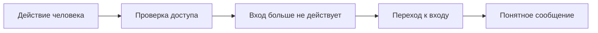
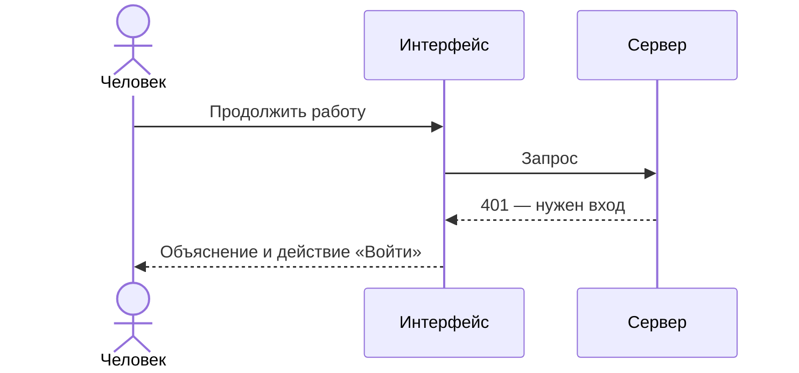
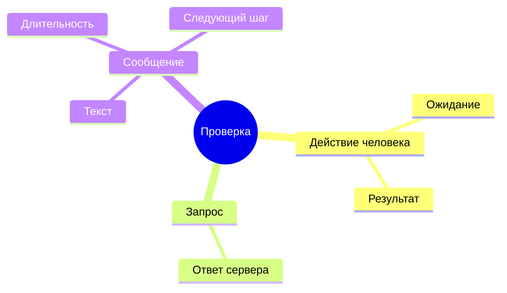
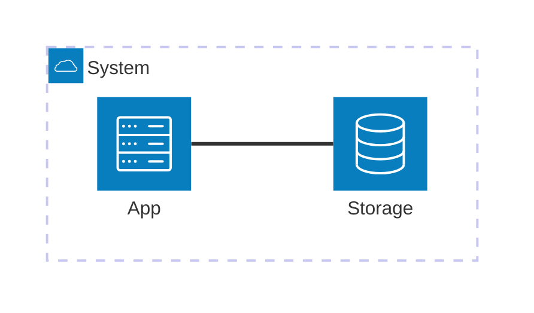

# Сообщение поможет человеку продолжить работу

Я бы оставил важное сообщение на экране до решения человека и добавил в него действие «Войти».
Так будет понятно, почему работа остановилась и как её продолжить. Это пример предлагаемого
решения: изменение ещё не выполнено, а причина отдельной жалобы остаётся неизвестной.

## Что стоит изменить

Человеку нужны объяснение остановки и понятный следующий шаг. Короткое исчезающее сообщение
можно пропустить, даже если оно появилось вовремя.

| Сейчас в этом примере | Предлагаемое поведение | Как принять решение |
| --- | --- | --- |
| Сообщение быстро исчезает | Остаётся до действия человека | Проверить, можно ли прочитать и закрыть его без спешки |
| Дальнейшее действие находится в другом месте | «Войти» есть в самом сообщении | Проверить возвращение к работе |

> Это иллюстрация объяснения. Таблица и схемы не подтверждают поведение реального приложения.

::::: details Почему сообщение может появиться слишком поздно
Между остановкой работы и объяснением на экране есть несколько шагов. На каждом из них нужно
проверить, сохраняется ли причина остановки.

Схема показывает смысл последовательности: действие приводит к проверке доступа, отказ —
к переходу, а переход должен завершиться объяснением для человека.



:::: details Где шаги зависят друг от друга
После отказа браузеру нужно передать причину новой странице. Сам переход ещё не доказывает,
что сообщение действительно показали.

На этой глубине можно назвать участников точнее. UI — интерфейс в браузере; сервер проверяет
доступ. Ответ `401` сообщает, что для запроса нужен действующий вход.

Схема разделяет запрос и показ сообщения: это две разные точки наблюдения.



::: details На что опираться при проверке
Для одного вывода нужны наблюдения на нескольких шагах. Неудачный запрос, сохранённая причина
и сообщение на экране подтверждают разные части объяснения.

Карта группирует эти наблюдения, чтобы результат отдельной проверки не подменял весь сценарий.



Код ниже — условный пример записи результата, а не выполненная проверка. Длинная строка должна
прокручиваться внутри своего блока, сохраняя удобную ширину страницы.

```js
const observation = { request: "401", messageVisible: true, nextAction: "sign-in", evidence: "This is a deliberately long illustrative source line whose meaning remains readable without changing the width of the surrounding document or pretending that this fictional observation occurred." };
```

Иллюстрация использует локальное изображение; при сборке оно становится частью файла.


:::
::::
:::::

## Что остаётся проверить

Нужно пройти исходное действие человека и увидеть сообщение после реального отказа. Пока это
не сделано, предложение остаётся предложением; мы не можем объявить исходную жалобу закрытой.

::: details Какие части системы участвуют
Интерфейс обращается к серверу, а сервер использует сохранённое состояние. Наличие этих частей
само по себе не доказывает, где возникла ошибка.

Архитектурная схема показывает границы участников. Она не выполняет запросы и не содержит
адресов реального окружения.


:::
