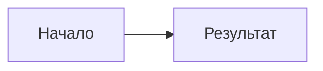
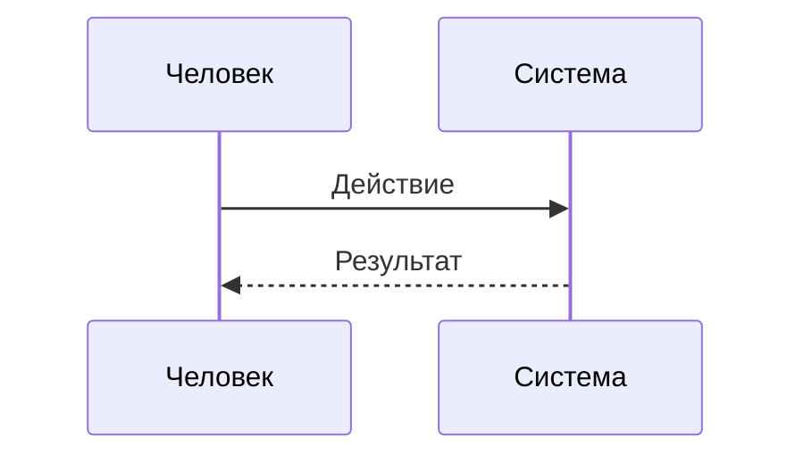
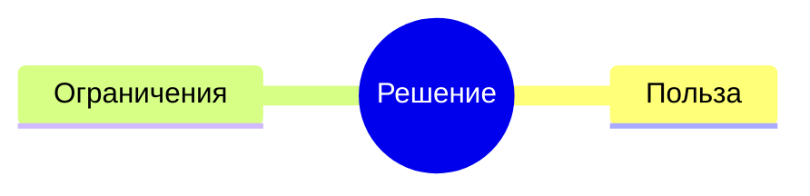
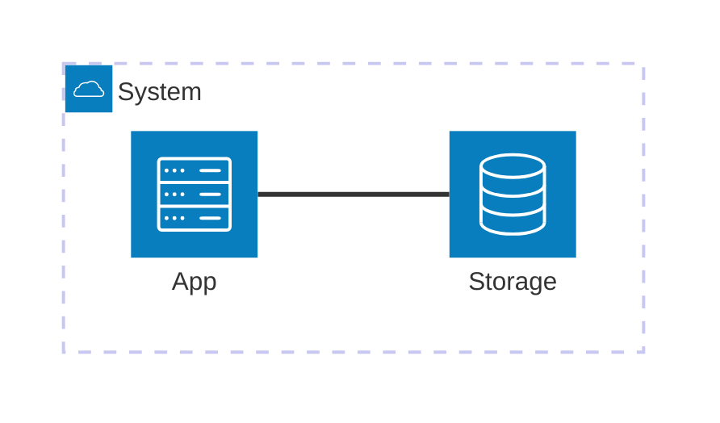
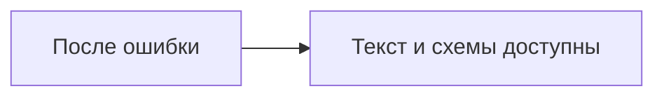

# Проверка отображения схем

Это данные для проверки браузера, а не реальное исследование. Одна схема намеренно неверна:
ошибка должна остаться локальной, а следующая правильная схема должна отобразиться.

## Доступная сразу схема

Схема показывает один переход.



::::: details Закрытая часть с несколькими уровнями
Первая скрытая схема показывает порядок общения.



:::: details Более узкая проверка
Карта собирает две стороны решения.



::: details Самая глубокая часть
Схема делит систему на обработку и хранение.


:::
::::
:::::

## Ошибка одной схемы

Следующий блок специально содержит неверный текст.

```mermaid
this is not a valid diagram
```

Следующая схема должна успешно нарисоваться после предыдущей ошибки.


